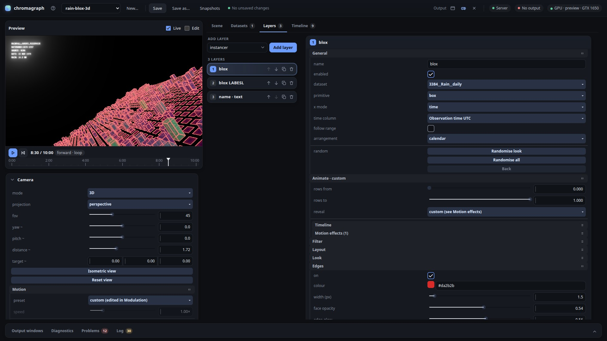
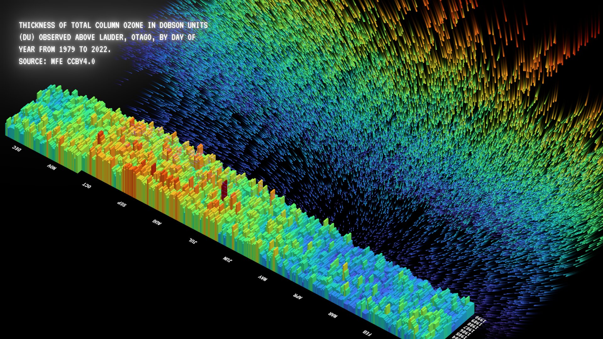

-important)
[](https://nodejs.org/)
[](LICENSE)


# chromagraph

A realtime data-visualisation instrument. It loads CSV/JSON files, maps their columns onto
2D and 3D layers, and plays the result live to a projector or screen at 1920×1080. Use it
to explore data at a desk, or to run unattended installations for hours.

Interface


Output window


## What you need

- **Node.js** 22.12 or newer, with npm.
- **Google Chrome or Chromium**, recent, with hardware acceleration on. The output needs
  WebGL2. Other browsers are untested.
- **A graphics card.** A dedicated GPU is recommended for big scenes: the target is 60 fps
  with about 200,000 shapes on a GTX 1650-class card (4 GB). Integrated graphics are fine
  for smaller scenes. Reflections, depth of field, blur and shadows each cost extra.
- **One 1920×1080 output.** The picture is always rendered at 1080p and scaled to fit
  whatever display shows it.
- **Operating system:** developed and tested on Ubuntu Linux. The server and both windows
  should run anywhere Node and Chrome do, but the **Output** buttons (which open the output
  window for you) currently work on Linux only. Elsewhere, open the output by hand (below).

## Install and start

```bash
git clone https://github.com/edmonkey-nz/chromagraph.git
cd chromagraph
npm install
npm run dev
```

Then open **http://127.0.0.1:8080/control** in Chrome. That is the control window.

The output is a second window, at **http://127.0.0.1:8080/output**:

- **Linux:** use the **Output** buttons at the top right of the control window: open in a
  window, open full screen on the projector (the second screen), or close. The output gets
  its own Chrome profile, so it never mixes with your normal browsing.
- **Anywhere:** open the output URL in a new Chrome window, drag it to the projector and
  press **f** for full screen.

The server reopens the last project, and the output boots straight into it, even with no
control window open. Choosing another project from the list starts its timeline from zero.
Stop the server with **Ctrl+C**. Use `PORT=9000 npm run dev` for another port.

## Check the graphics card (before a show)

The **GPU** pill at the top right of the control window shows which graphics card the
output is rendering on: green for NVIDIA, amber for another GPU, red for software
rendering. Hover over it for the full renderer name. With no output open, it shows the
preview's. `chrome://gpu` ("GL_RENDERER") tells you the same.

On a laptop with two GPUs, make sure Chrome uses the dedicated one:

- **Windows:** Settings → System → Display → Graphics → add Chrome → **High performance**.
- **macOS:** usually automatic. If not, turn off automatic graphics switching (System
  Settings → Battery → Options) while the show runs.
- **Linux with NVIDIA hybrid graphics:** start Chrome with PRIME offload, under X11 (on a
  Wayland desktop Chrome otherwise sticks to the integrated GPU). The **Output** buttons do
  this for you when the NVIDIA driver is loaded. By hand, quit Chrome first, then:

  ```sh
  __NV_PRIME_RENDER_OFFLOAD=1 __GLX_VENDOR_LIBRARY_NAME=nvidia \
  google-chrome --ozone-platform=x11 --kiosk http://127.0.0.1:8080/output/
  ```

The warning banner and the amber pill currently mean "not NVIDIA", so they also show on
machines with a dedicated AMD or Intel card. Check the renderer name instead.

## Installations

Use the production build: in dev mode, editing a source file reloads the output.

```bash
npm run build && npm start
```

- In production the output caches itself and its data. If the server stops, the output
  keeps showing the last good picture, and can even reload while the server is down.
- Run Chrome in kiosk mode (`--kiosk`) on the projector, or use **Output → On projector**
  on Linux.
- Turn off screen blanking, sleep and notifications, and keep a laptop on mains power.
- Calibrate the projector in **Scene → Calibration** (four-corner keystone with a test
  pattern). Calibration is saved per venue in `output-profiles/`, separate from projects.

## Your data

- **Import** CSV, TSV or JSON (an array of records, or an object of column arrays) in the
  **Datasets** tab. Files up to
  about 2 MB (50,000–100,000 rows) work well. The file is copied into the project and
  never changed.
- Each column is read as numbers, times, categories or text. Empty cells stay missing:
  nothing is filled in or smoothed unless a layer asks for it, and gaps in time stay
  visible.
- **Treat as missing:** if a file writes "NA", "-" or similar for no value, list those
  markers on the dataset, and the column reads as numbers again. When a mostly-numeric
  column has a few odd texts, the Datasets tab offers them with a one-click fix.
- **View rows** opens the table: sort by any column, or jump to a row. Problems in a file
  are listed per file, with row numbers.
- Times are kept in UTC and shown in each dataset's timezone (Pacific/Auckland by default).
- Give each dataset a source, link and attribution, for credits and QR codes.
- **Filters:** a layer can keep only the rows whose category is one of the values you tick
  (for example, Sex: Male). Each layer has its own filter on its own dataset; datasets are
  never joined.

## Saving your work

- **Autosave:** every change is saved within half a second, safely (a crash mid-save never
  corrupts a project), and the previous save is kept as `.bak`.
- **Save as…** copies a project, data included. **Snapshots** are named versions you can
  restore; restoring first keeps a "before restore" snapshot.
- Projects live in `projects/<name>/`. Imported data files are copied into its `data/`
  folder and never modified. Copy `projects/` to back up or move your work.

## What it can do

**Layers**, stacked in order like an editing timeline:
- **Instancer:** points, squares, bars, boxes or spheres in linear, grid, calendar, radial
  or spiral layouts. Map a column to x as well as y for scatter plots. It has a cloner,
  edge styles for boxes, and labels along the layout (years, decades, every N rows). Grid
  and calendar labels can sit at their point or be pinned to either side of the row. A
  calendar can also label the days axis with days, weeks, months, quarters or seasons, with
  faint division lines.
  **Axes & values** add value labels on each mark, a category axis and a value axis with
  gridlines. The **Bar chart** preset sets one up in a click.
- **Line:** line charts with weekly, monthly or yearly averaging (or every N rows), and
  ridgelines with fill. **Split** draws one line per category, each in its own colour and
  named at its tip, or **stacks** them into a stacked area or streamgraph. A **min–max
  band** shades each period's range behind its average. Lines have the same axes and
  value labels. The **Line chart (aggregated)** entry in Add layer sets one up.
- **Density map:** where the rows cluster, counted into a smoothed colour map, or shown as
  3D clouds of dots (with a third column for depth). Good for 100,000 points that would
  otherwise be a blur.
- **Horizon chart:** many series stacked as thin strips, each folded into bands of colour,
  so long records fit in little height.
- **Heat map** (including a year × day calendar), **small multiples**, **hierarchy**
  (dendrogram, sunburst, treemap…) and **3D surface**.
- **Text:** words, or live values from the data at the playhead. Numbers and dates keep the
  file's formatting, so text doesn't jump. Press **Insert credit** on a text layer (or type
  `{@credit}`, `{@source}`, `{@url}` or `{@attribution}`) to show a dataset's credits.
- **Reflection plane:** a mirror floor for 3D scenes.
- **QR code:** a scannable "more info" link, typed in or taken from the dataset's link.
  Dark on light scans best; keep the margin at 4 and, on a wall, make it at least about
  20 cm wide. Glow and blur can stop it scanning.

**Mapping:** any column to position, size, colour, opacity or rotation, through linear,
log, sqrt or stepped scales and colour ramps.

**Animation:**
- Modulators (LFO, noise, ramp, keyframes) on almost any number, on a looping timeline
  from seconds to 24 hours. It plays forward, in reverse or ping-pong, with optional fades
  and a gap before each restart.
- Each layer's **Animate** folder reveals a record over time: build up, or a sliding
  window. **Reverse** plays it from the end of the file back to the start, for files that
  list the newest rows first. Its other motion effects sit underneath. Layers can run on
  their own timelines.
- The **Timeline** tab shows every animated value as a lane you can edit.
- **Scenes:** capture looks and morph between them (0.1–10 s).
- **Randomise** a layer's look (or its columns too), and step back through the last ten.

**Camera:** 2D, 3D perspective or isometric. Motion presets (orbit, swing, zoom, drift…)
with their own play, pause and speed, and depth of field with an animatable focus.
**Follow** keeps the camera on a line's newest point as it plots, like driving along a
road. **Follow path** shows the whole route ahead, dimmed, while the line draws over it,
and a **loop flight** circles back to the start when the line restarts.

**Look:** per-layer glow, motion trails, drop shadow and blur. **Fixed to screen** keeps
titles still while the 3D camera moves. Text uses VT323, a 1970s terminal face, or a sans.

**Control window:** the live preview (with move/rotate/scale editing and camera orbit),
the timeline strip and the camera on the left; tabs for Scene, Datasets, Layers and
Timeline on the right; output windows, diagnostics, problems and the log in a drawer at
the bottom. The header has the project list, save and snapshots, the output buttons, and
the server, output and GPU pills. The **?** next to the title shows ABOUT.md.

## Development

See `CLAUDE.md` for the constraints, architecture and code map, and `FUTURE.md` for the
wish list.

```bash
npm test            # Vitest (pure Node, no GPU)
npm run typecheck   # TypeScript 7, strict
npm run build       # production bundle
```

## Licence

MIT, see [LICENSE](LICENSE). The bundled VT323 font is under the SIL Open Font Licence.
